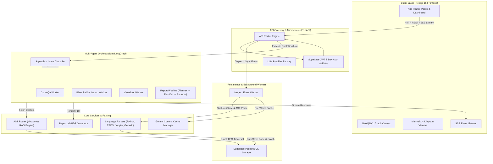
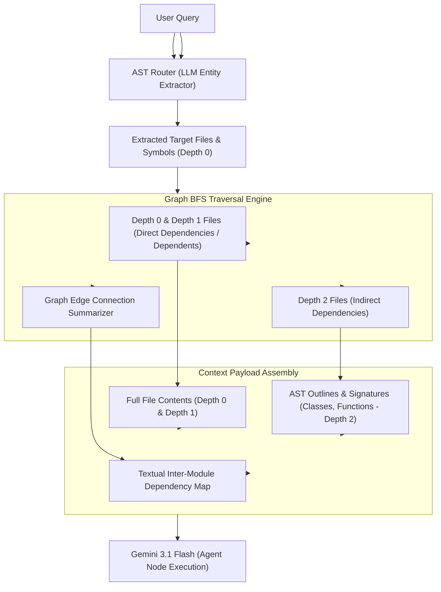
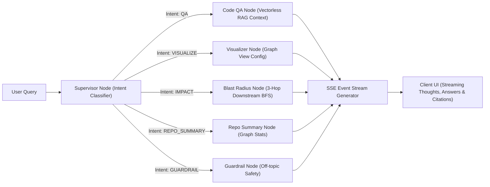
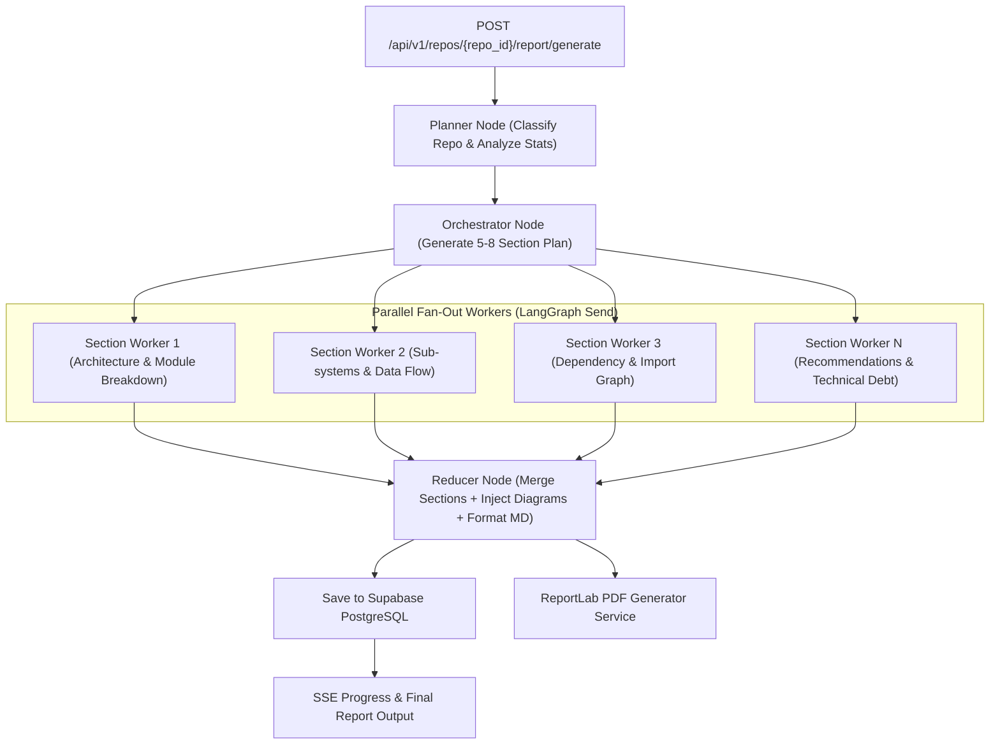
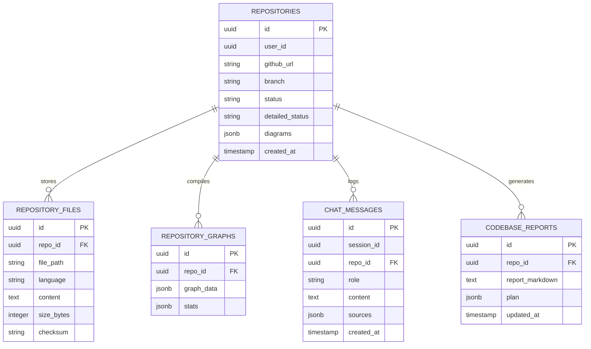

<p align="center">
  
</p>

<h1 align="center">GitMesh — AI-Powered Codebase Intelligence & Graph-Native AST Engine</h1>

<p align="center">
  <b>Vectorless RAG • Multi-Agent LangGraph Workflows • Interactive Neo4j NVL Graph Visualizer • Inngest Background Pipeline</b>
</p>

<p align="center">
  <a href="https://nextjs.org"></a>
  <a href="https://fastapi.tiangolo.com"></a>
  <a href="https://www.python.org"></a>
  <a href="https://www.typescriptlang.org"></a>
  <a href="https://inngest.com"></a>
  <a href="https://supabase.com"></a>
  <a href="https://deepmind.google/technologies/gemini/"></a>
</p>

---

## Section 1: Executive Overview

GitMesh is an enterprise-grade, developer-centric codebase visualization, structural intelligence, and automated architectural auditing platform. Traditional Retrieval-Augmented Generation (RAG) systems attempt to answer code queries by chunking source code files into arbitrary line blocks and indexing them inside flat vector databases. This approach fundamentally fails in software engineering tasks because vector similarity search lacks structural awareness: it discards function call graphs, class inheritance trees, cross-module import paths, type definitions, and downstream dependency chains.

GitMesh replaces vector chunking with **Vectorless RAG via Deterministic Abstract Syntax Tree (AST) Graph Traversal**. During repository ingestion, GitMesh parses source code files into a unified, symbolic knowledge graph containing explicit nodes (`File`, `Class`, `Function`, `Method`) and typed relationships (`IMPORTS`, `CALLS`, `HAS_METHOD`).

When a developer submits a query, GitMesh identifies target entry points, performs Breadth-First Search (BFS) graph traversal across the dependency network, and builds a depth-stratified context payload. This context is supplied to a stateful **LangGraph Multi-Agent Runtime**, driving precise Q&A, instant 3-hop **Blast Radius Analysis**, real-time **Neo4j NVL Graph Visualizations**, and automated **Deep Codebase Architectural Audits** exported as publication-ready A4 PDF reports.

---

## Section 2: Core System Capabilities

### 1. Vectorless RAG Engine
- Eliminates lossy embedding spaces and approximate nearest-neighbor vector searches.
- Uses LLM structured output to identify entry point files and target symbols from user queries.
- Executes deterministic BFS graph traversal across the codebase dependency network.
- Assembles depth-stratified context payloads:
  - Depth 0 (Target files) and Depth 1 (Direct dependencies & dependents): Full source code contents.
  - Depth 2 (Indirect dependencies): AST signatures, function parameters, class outlines, and docstrings.
  - Dependency Map Summary: Explicit text representation of active inter-module relationships.

### 2. Interactive Neo4j NVL Graph Canvas
- Powered by `@neo4j-nvl/react` and custom HTML5 canvas rendering engines.
- Renders file import networks, function call chains, and class-method relationships with interactive physics force-directed layouts.
- Provides real-time filtering by entity type (`file`, `class`, `function`), node selection inspection, zoom-to-fit, and dark glassmorphic UI controls.

### 3. Stateful LangGraph Multi-Agent Runtime
- Driven by a Supervisor Router node that classifies developer intent using Pydantic structured output models with fallback JSON parsing.
- Routes incoming queries to domain-specific agent nodes:
  - **Code QA Node**: Deep code understanding using Vectorless RAG context stuffing and line-accurate source citations.
  - **Visualizer Node**: Subsets knowledge graphs dynamically to configure client-side NVL viewports.
  - **Blast Radius Node**: Traverses downstream dependency chains up to 3 hops to compute change impact.
  - **Repo Summary Node**: Computes statistical summaries, file distribution metrics, and language breakdowns.
  - **Guardrail Node**: Intercepts off-topic or malformed queries safely.

### 4. Deep Codebase Architectural Report Engine
- Uses a multi-agent Fan-Out / Fan-In LangGraph pipeline:
  - **Planner Node**: Classifies repository domain (Fullstack, Backend, Frontend, CLI, Microservice) and evaluates structural graph metrics.
  - **Orchestrator Node**: Constructs a structured 5 to 8 section analytical blueprint.
  - **Parallel Section Workers**: Executes section authoring concurrently using LangGraph `Send` primitives, injecting source snippets for targeted modules.
  - **Reducer Node**: Merges section drafts, embeds auto-generated Mermaid architecture diagrams, enforces generation timestamps, and outputs complete Markdown.
- **A4 PDF Export**: Integrates ReportLab rendering to compile Markdown reports into styled, publication-grade PDF documents.

### 5. Gemini Context Cache Pre-Warming
- Automatically constructs and registers Google Gemini API Context Caches (`gemini-3.1-flash-lite`) during the ingestion pipeline.
- Reduces token consumption by up to 80% on large codebases while lowering request latency for iterative chat sessions.

### 6. Asynchronous Event-Driven Ingestion (Inngest)
- Non-blocking background worker execution triggered via `repo/sync.requested` events.
- Orchestrates repository shallow cloning, multi-language AST parsing, symbolic edge stitching, Supabase persistence, and background diagram generation with progress updates (`queued` -> `cloning` -> `parsing` -> `saving` -> `diagrams` -> `completed`).

---

## Section 3: Architecture Diagrams & Flowcharts

### 3.1 End-to-End System Architecture



---

### 3.2 Repository Ingestion & Symbolic Graph Compilation Pipeline

```mermaid
sequenceDiagram
    autonumber
    actor Dev as Developer / User
    participant FE as Next.js Frontend
    participant API as FastAPI Backend
    participant Inn as Inngest Engine
    participant Git as Git Process / Temp Storage
    participant Parser as AST Parser Engine
    participant DB as Supabase PostgreSQL
    participant Cache as Gemini Context Cache

    Dev->>FE: Initiate Repo Sync (URL, Branch)
    FE->>API: POST /api/v1/repos/sync
    API->>DB: Insert Repository Row (status: "queued")
    API->>Inn: Dispatch Event "repo/sync.requested"
    API-->>FE: Return HTTP 201 Created (repo_id)

    rect rgb(25, 35, 55)
        Note over Inn,Git: Async Background Ingestion Worker
        Inn->>DB: Update detailed_status -> "cloning"
        Inn->>Git: Shallow Clone Repository (depth=1)
        Inn->>DB: Update detailed_status -> "parsing"
        Inn->>Parser: Walk Directory & Execute AST Parsers (Python, TS/JS, Notebooks)
        Parser-->>Inn: Return Extracted Nodes (File, Class, Function) & Raw Imports
        Inn->>Inn: Resolve Symbolic Import Paths & Stitch Edges (IMPORTS, CALLS, HAS_METHOD)
        Inn->>DB: Update detailed_status -> "saving"
        Inn->>DB: Bulk Save Repository Files & Unified Graph JSON
        Inn->>Cache: Pre-warm Gemini Context Cache
        Inn->>DB: Update detailed_status -> "diagrams" & Generate Mermaid Diagrams
        Inn->>DB: Update status -> "completed", detailed_status -> "completed"
    end

    FE->>API: Poll GET /api/v1/repos/{id}/status
    API-->>FE: Return status: "completed"
```



---

### 3.3 Vectorless RAG Depth Traversal & Context Construction



---

### 3.4 Multi-Agent Chat Routing & Execution Workflow



---

### 3.5 Multi-Agent Deep Architectural Report Pipeline



---

## Section 4: Deep-Dive Technical Mechanics

### 4.1 AST Parsing Engine (`backend/app/services/parsers/`)
GitMesh avoids simple regex-based code analysis by using AST parsers:
1. **Python Parser (`python_parser.py`)**: Uses Python's native `ast` module to walk module trees. It extracts:
   - File-level import statements (`ast.Import`, `ast.ImportFrom`).
   - Class definitions (`ast.ClassDef`) with line numbers and docstrings.
   - Function & Method definitions (`ast.FunctionDef`, `ast.AsyncFunctionDef`) with full type signatures, parameters, async indicators, line ranges, and call expressions (`ast.Call`).
2. **TypeScript / JavaScript Parser (`ts_parser.py`)**: Uses regular expression tree matching and regex lexing to parse ES6 imports, relative imports (`import x from './y'`), exported classes, interfaces, function declarations, arrow functions, and method calls.
3. **Generic & Notebook Parsers (`generic_parser.py`)**: Parses markdown files, YAML, JSON, Dockerfiles, and Jupyter Notebooks (`.ipynb`), extracting cell contents while filtering out heavy base64 cell outputs to prevent buffer overflows.

### 4.2 Symbolic Import Resolution Algorithm (`backend/app/workers/inngest_fns.py`)
To map code files into a graph, raw import strings must be resolved to absolute repository relative file paths. `resolve_import_path()` handles multi-language resolution:
- **TypeScript Relative & Alias Imports**: Translates relative paths (`./utils`, `../components/button`) and module path aliases (`@/components/ui/card`) to candidate extensions (`.ts`, `.tsx`, `.js`, `.jsx`, `/index.ts`).
- **Python Package & Relative Imports**: Resolves relative dot notation (`from .config import settings`, `from ..core.security import ...`) and absolute module paths (`from app.db.pg_client import ...`) by checking existing repository files and `__init__.py` markers.

### 4.3 Vectorless RAG BFS Graph Traversal (`backend/app/services/ast_router.py`)
`ASTRouter` implements deterministic graph routing:
1. **Entity Extraction**: Invokes Gemini with structured output (`TargetEntities`) to parse the user's natural language query against a repository file listing, returning `files` and `symbols`.
2. **Bi-Directional BFS Traversal**: `walk_graph()` constructs an adjacency graph combining `IMPORTS` (dependencies) and `IMPORTED_BY` (dependents).
3. **Depth Classification**:
   - `Depth 0 & 1`: Assigned to `depth_1_files` set. Full text contents are loaded from PostgreSQL. Notebook cell outputs are stripped, and files >150KB are truncated gracefully.
   - `Depth 2`: Assigned to `depth_2_files` set. Full text is excluded; only class and function signatures, parameters, and docstrings are included.
4. **Context Construction**: Assembles the prompt payload into three explicit sections: `DETAILED FILE CONTEXT (Depth 0 & 1)`, `OUTLINE / SIGNATURE CONTEXT (Depth 2)`, and `RELEVANT CODE DEPENDENCY GRAPH`.

### 4.4 Downstream Blast Radius Calculation (`backend/app/api/routes/repos.py`)
The Blast Radius endpoint (`GET /api/v1/repos/{repo_id}/blast-radius?file_path=...`) calculates downstream impact when a target file is modified:
- Builds an in-memory graph from stored graph JSON nodes and edges.
- Executes BFS up to a max depth of 3 hops following outgoing dependency edges.
- Identifies all affected file nodes and individual symbol nodes (`Class`, `Function`), returning an ordered list of downstream components that require re-testing or refactoring.

### 4.5 Multi-Agent Report Pipeline & PDF Rendering (`backend/app/agents/report_graph.py` & `pdf_generator.py`)
- **Planner Node**: Inspects repository statistics (file count, class count, function count, language breakdown) and classifies the project into architecture profiles.
- **Orchestrator Node**: Generates a targeted section plan object (`ReportPlan`).
- **Section Workers**: Executed in parallel using LangGraph `Send`. Each worker loads specific source file contents, writes a section focused on its allocated goal, and enforces word count targets.
- **Reducer Node**: Combines section outputs, injects pre-generated Mermaid diagrams (Architecture, Data Flow, User Flow), and guarantees accurate generation date formatting using UTC regex replacement.
- **ReportLab PDF Generator**: Converts Markdown into formatted A4 PDF documents with custom margins, styled headers, code block shading, table formatting, and page numbering.

---

## Section 5: Technology Stack Specification

| Subsystem | Component / Library | Purpose & Architectural Role |
| :--- | :--- | :--- |
| **Frontend UI** | Next.js 15 (App Router, React 19) | Server rendering, streaming layout, app routing |
| **Frontend Styling** | TailwindCSS, Radix UI | Glassmorphic design tokens, responsive layouts, primitives |
| **Graph Canvas** | `@neo4j-nvl/react`, HTML5 Canvas | Interactive 2D/3D graph visualization with physics layout |
| **Diagram Renderer** | Mermaid.js | Dynamic rendering of architecture, user flow, and data flow diagrams |
| **Backend API** | FastAPI (Python 3.11+) | Async HTTP REST endpoints, Server-Sent Events (SSE) streaming |
| **Background Processing** | Inngest Engine | Event-driven background queue for repository ingestion pipelines |
| **Agent Framework** | LangGraph / LangChain Core | Stateful multi-agent graph routing, parallel fan-out, state reduction |
| **LLM Provider** | Google Gemini 3.1 Flash / Lite | Intent routing, vectorless context processing, context caching |
| **Database Layer** | Supabase (PostgreSQL) | Persistence of repo metadata, source files, unified graphs, reports |
| **AST Parsing** | Python AST, Regex Parser Engine | Multi-language parsing of classes, functions, and import statements |
| **Document Rendering** | ReportLab | Compilation of Markdown codebase reports into downloadable A4 PDFs |

---

## Section 6: Complete Repository Codebase Structure

```
GitMesh/
├── README.md                          # Comprehensive Repository Documentation
├── .vercelignore                      # Deployment Exclusion Rules
├── gitmesh-logo-1.png                 # Legacy Branding Asset
│
├── backend/                           # FastAPI Python Backend Application
│   ├── Dockerfile                     # Container Deployment Blueprint
│   ├── requirements.txt               # Python Dependencies Specification
│   ├── migrate_activate_repos.py      # Database Migration Helper Utility
│   ├── test_graph.py                  # Graph Execution Test Script
│   ├── test_vectorless_rag.py         # Vectorless RAG Engine Verification Script
│   └── app/
│       ├── main.py                    # FastAPI Entrypoint & Application Factory
│       ├── api/
│       │   ├── dependencies.py        # Database & Auth Dependency Injectors
│       │   └── routes/
│       │       ├── chat.py            # Chat & Streaming SSE Endpoint Handlers
│       │       ├── providers.py       # Custom LLM API Key Routes
│       │       ├── report.py          # Codebase Report & PDF Export Endpoints
│       │       ├── repos.py           # Repo Ingestion, Graphs & Blast Radius Routes
│       │       └── webhooks.py        # External Webhook Event Receivers
│       ├── core/
│       │   ├── config.py              # Pydantic Settings & Environment Loader
│       │   └── security.py            # Supabase Auth Verification & Developer Bypass
│       ├── db/
│       │   ├── pg_client.py           # Supabase PostgreSQL Data Access Layer
│       │   └── neo4j_client.py        # Neo4j Client Helper Connection
│       ├── schemas/
│       │   ├── llm_config.py          # Custom LLM Configuration Schemas
│       │   ├── requests.py            # Pydantic API Request Payloads
│       │   └── responses.py           # Pydantic API Response Schemas
│       ├── services/
│       │   ├── ast_router.py          # Vectorless RAG BFS Traversal Engine
│       │   ├── context_caching.py     # Gemini API Context Cache Pre-Warming
│       │   ├── diagram_generator.py   # Dynamic Mermaid Diagram Generator
│       │   ├── llm_factory.py         # LLM Provider Initializer & Resolver
│       │   ├── pdf_generator.py       # ReportLab PDF Document Exporter
│       │   └── parsers/
│       │       ├── python_parser.py   # Python AST & Symbol Extractor
│       │       ├── ts_parser.py       # TypeScript / JavaScript Lexical Parser
│       │       └── generic_parser.py  # Generic File & Notebook Parser
│       ├── agents/
│       │   ├── graph.py               # LangGraph Chat Multi-Agent Workflow
│       │   ├── prompts.py             # Agent System Prompts & Instructions
│       │   ├── state.py               # Chat Agent State Schema
│       │   ├── report_graph.py        # LangGraph Deep Report Multi-Agent Pipeline
│       │   ├── report_prompts.py       # Architectural Report System Prompts
│       │   ├── report_schemas.py      # Report Plan & Section Schemas
│       │   ├── report_state.py        # Report Pipeline State Schema
│       │   └── nodes/
│       │       ├── blast_radius.py    # Downstream Impact Analysis Node
│       │       ├── code_qa.py         # Vectorless RAG Code QA Node
│       │       ├── guardrail.py       # Query Guardrail Safety Node
│       │       ├── repo_summary.py    # Codebase Summary Statistics Node
│       │       └── visualizer.py      # Graph View Resolution Node
│       └── workers/
│           └── inngest_fns.py         # Background Repo Ingestion & Graph Worker
│
└── frontend/                          # Next.js 15 Web Frontend Application
    ├── package.json                   # Node.js Package Manifest
    ├── next.config.ts                 # Next.js Configuration
    ├── tailwind.config.ts             # Tailwind CSS Design Tokens
    ├── public/
    │   ├── developer-logo-refined.svg # Refined GitMesh Vector Logo Asset
    │   ├── gitmesh-logo-vector.svg    # Secondary Branding Graphic
    │   └── animation.gif              # Dashboard Interaction Recording
    ├── app/
    │   ├── layout.tsx                 # Root Layout & Theme Container
    │   ├── page.tsx                   # Landing Page & Product Overview
    │   ├── dashboard/                 # Interactive Workspace & Chat Dashboard
    │   ├── developers/                # Developer Portal & API Documentation
    │   ├── how-it-works/              # Architecture Explanation Page
    │   ├── pricing/                   # Pricing Tiers & Plan Matrix
    │   └── security/                  # Security & Compliance Overview
    └── components/
        ├── ai-elements/               # Streaming Chat Thought & Plan Visualizers
        └── ui/                        # UI Components
            ├── ChatMarkdown.tsx       # Syntax-Highlighted Markdown Renderer
            ├── MermaidDiagram.tsx     # Client-Side Mermaid Diagram Renderer
            └── NvlGraphViewer.tsx     # Neo4j NVL Interactive Physics Canvas
```

---

## Section 7: Complete API Reference Documentation

### 7.1 Repository Management Endpoints (`/api/v1/repos`)

| Method | HTTP Endpoint | Description | Auth Required |
| :--- | :--- | :--- | :---: |
| `POST` | `/api/v1/repos/sync` | Enqueues a GitHub repository for background cloning & AST parsing | Yes |
| `GET` | `/api/v1/repos` | Lists all repositories owned by the authenticated user | Yes |
| `GET` | `/api/v1/repos/by-name/{username}/{repo_name}` | Retrieves repository metadata using GitHub path parameters | Yes |
| `GET` | `/api/v1/repos/{repo_id}/status` | Checks current ingestion status (`queued`, `processing`, `completed`, `failed`) | Yes |
| `DELETE` | `/api/v1/repos/{repo_id}` | Deletes a repository and all associated files, graphs, and reports | Yes |

### 7.2 Knowledge Graph & Code Inspection Endpoints (`/api/v1/repos/{repo_id}/*`)

| Method | HTTP Endpoint | Description | Auth Required |
| :--- | :--- | :--- | :---: |
| `GET` | `/api/v1/repos/{repo_id}/graph-stats` | Returns aggregate counts of files, classes, functions, and edges | Yes |
| `GET` | `/api/v1/repos/{repo_id}/dependency-graph` | Returns file-level nodes and `IMPORTS` edges | Yes |
| `GET` | `/api/v1/repos/{repo_id}/full-graph` | Returns all flattened entity nodes and relationships | Yes |
| `GET` | `/api/v1/repos/{repo_id}/call-graph` | Returns function nodes and function invocation (`CALLS`) edges | Yes |
| `GET` | `/api/v1/repos/{repo_id}/class-graph` | Returns class & method nodes with `HAS_METHOD` edges | Yes |
| `GET` | `/api/v1/repos/{repo_id}/blast-radius?file_path=...` | Calculates 3-hop downstream impact analysis for a specified file | Yes |
| `GET` | `/api/v1/repos/{repo_id}/file?file_path=...` | Retrieves raw source content for a single repository file | Yes |
| `GET` | `/api/v1/repos/{repo_id}/summary` | Returns language breakdown statistics and file distribution | Yes |
| `GET` | `/api/v1/repos/{repo_id}/diagrams` | Retrieves cached or on-the-fly generated Mermaid diagrams | Yes |

### 7.3 Multi-Agent AI Chat Endpoints (`/api/v1/chat/*`)

| Method | HTTP Endpoint | Description | Auth Required |
| :--- | :--- | :--- | :---: |
| `POST` | `/api/v1/chat/send` | Sends a message and receives a synchronous assistant response | Yes |
| `POST` | `/api/v1/chat/stream` | Streams thoughts, routing decisions, and final text via Server-Sent Events | Yes |
| `GET` | `/api/v1/chat/history?session_id=...&repo_id=...` | Fetches complete message history for a specified chat session | Yes |
| `GET` | `/api/v1/chat/sessions?repo_id=...` | Lists all chat sessions associated with a repository | Yes |
| `DELETE` | `/api/v1/chat/message/{message_id}` | Deletes a specific message from chat history | Yes |
| `POST` | `/api/v1/chat/feedback` | Submits user rating feedback (thumbs up / thumbs down) for a message | Yes |

### 7.4 Architectural Report Endpoints (`/api/v1/repos/{repo_id}/report/*`)

| Method | HTTP Endpoint | Description | Auth Required |
| :--- | :--- | :--- | :---: |
| `POST` | `/api/v1/repos/{repo_id}/report/generate` | Triggers parallel multi-agent report generation via SSE stream | Yes |
| `GET` | `/api/v1/repos/{repo_id}/report` | Fetches the saved codebase report markdown for a repository | Yes |
| `DELETE` | `/api/v1/repos/{repo_id}/report` | Deletes the saved report for a repository | Yes |
| `POST` | `/api/v1/repos/{repo_id}/report/export-pdf` | Compiles Markdown into a downloadable A4 PDF stream | No |

---

## Section 8: Database & Knowledge Graph Schema

### 8.1 Supabase PostgreSQL Database Schema



### 8.2 Unified Symbolic Graph Representation Schema
The `graph_data` JSON column in `REPOSITORY_GRAPHS` persists nodes and edges structured as follows:

```json
{
  "nodes": [
    {
      "id": "backend/app/services/ast_router.py",
      "label": "ast_router.py",
      "type": "file",
      "language": "python",
      "size_bytes": 9789,
      "symbols": [
        {
          "type": "class",
          "name": "ASTRouter",
          "start_line": 14,
          "end_line": 223,
          "docstring": "AST Router implements Vectorless RAG via deterministic graph traversal."
        },
        {
          "type": "function",
          "name": "route_query",
          "start_line": 30,
          "end_line": 80,
          "is_async": true,
          "signature": "(query: str, graph_data: Dict[str, Any], all_files_list: List[str]) -> Dict[str, Any]"
        }
      ]
    }
  ],
  "edges": [
    {
      "source": "backend/app/agents/graph.py",
      "target": "backend/app/services/llm_factory.py",
      "type": "IMPORTS"
    },
    {
      "source": "backend/app/services/ast_router.py#ASTRouter",
      "target": "backend/app/services/ast_router.py#walk_graph",
      "type": "HAS_METHOD"
    }
  ]
}
```

---

## Section 9: Quickstart & Developer Operations Guide

### Prerequisites
Before running GitMesh locally, install:
- **Node.js**: Version 18.0.0 or higher
- **npm** or **pnpm**
- **Python**: Version 3.11 or higher
- **Git**: Installed and available on system PATH
- **Inngest CLI**: Optional for monitoring background queues locally (`npx inngest-cli@latest dev`)

---

### 9.1 Backend Installation & Execution

```bash
# Navigate to backend directory
cd backend

# Create virtual environment
python -m venv venv

# Activate virtual environment
# Windows PowerShell:
.\venv\Scripts\Activate.ps1
# Linux / macOS:
source venv/bin/activate

# Install backend dependencies
pip install -r requirements.txt

# Create environment configuration
cp .env.example .env

# Launch FastAPI application server
uvicorn app.main:app --reload --host 0.0.0.0 --port 8000
```

The FastAPI Swagger documentation will be accessible at `http://localhost:8000/api/docs`.

---

### 9.2 Frontend Installation & Execution

```bash
# Navigate to frontend directory
cd frontend

# Install Node.js dependencies
npm install

# Create environment configuration
cp .env.local.example .env.local

# Launch Next.js development server
npm run dev
```

The web application will be accessible at `http://localhost:3000`.

---

### 9.3 Inngest Local Worker Execution

To execute background repository synchronization tasks locally:

```bash
npx inngest-cli@latest dev -u http://127.0.0.1:8000/api/v1/inngest
```

---

### 9.4 Environment Variables Matrix

#### Backend Configuration (`backend/.env`)

| Variable Name | Required | Description |
| :--- | :---: | :--- |
| `PROJECT_NAME` | No | Project title string (default: `"GitMesh"`) |
| `API_V1_PREFIX` | No | Base prefix for v1 API routes (default: `"/api/v1"`) |
| `DEBUG` | No | Boolean flag for verbose debug logging |
| `CORS_ORIGINS` | No | JSON array of permitted CORS client origins |
| `SUPABASE_URL` | **Yes** | Supabase PostgreSQL project API URL |
| `SUPABASE_ANON_KEY` | **Yes** | Supabase anonymous public API key |
| `SUPABASE_SERVICE_ROLE_KEY` | **Yes** | Supabase service role key (bypasses RLS for background ingestion) |
| `SUPABASE_JWT_SECRET` | **Yes** | Supabase JWT secret string used to verify user bearer tokens |
| `NEO4J_URI` | **Yes** | Bolt connection URI for Neo4j AuraDB instance |
| `NEO4J_USERNAME` | **Yes** | Authentication username for Neo4j instance |
| `NEO4J_PASSWORD` | **Yes** | Authentication password for Neo4j instance |
| `GOOGLE_API_KEY` | **Yes** | Google Gemini API key for agent execution & context caching |
| `INNGEST_EVENT_KEY` | **Yes** | Inngest key for dispatching asynchronous background events |
| `INNGEST_SIGNING_KEY` | **Yes** | Inngest signing key for validating webhook payloads |

#### Frontend Configuration (`frontend/.env.local`)

| Variable Name | Required | Description |
| :--- | :---: | :--- |
| `NEXT_PUBLIC_SUPABASE_URL` | **Yes** | Supabase project API URL exposed to browser auth client |
| `NEXT_PUBLIC_SUPABASE_ANON_KEY` | **Yes** | Supabase public anon key exposed to browser auth client |
| `NEXT_PUBLIC_API_URL` | **Yes** | Full URL of FastAPI backend (`http://localhost:8000/api/v1`) |

---

## Section 10: Rate Limiting & Developer Bypass

GitMesh enforces multi-tier access controls:
- **Free Account Tier**:
  - Maximum of 2 active synchronized repositories per user.
  - Rate limited to 3 daily chat messages per repository (15 monthly).
  - Rate limited to 1 codebase architectural report per repository per month.
- **Developer Bypass Accounts**:
  - Configured via `DEVELOPERS` list in `backend/app/core/config.py`.
  - Accounts matching specified GitHub usernames (e.g. `mihirpatel204`, `Priyanshu-Debugs`, `Sameer-0904`) automatically bypass repository limits, chat message quotas, and report generation rate limits.

---

## Section 11: License & Community

Contributions to GitMesh are welcome. Please open an issue or submit a pull request following standard software engineering practices.

This repository is distributed under standard open-source licensing guidelines. See the project repository for full terms.
